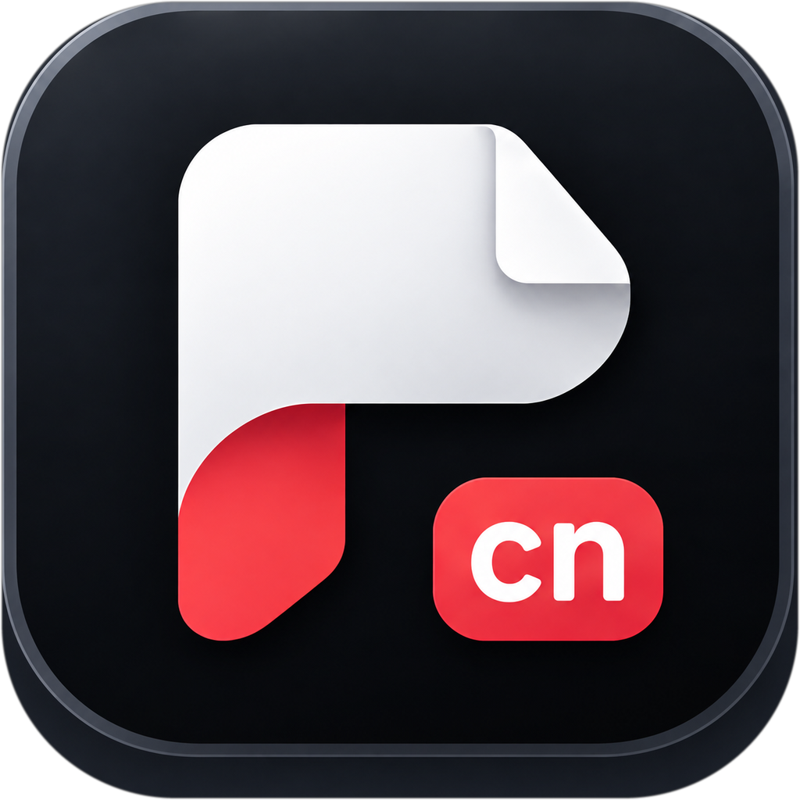

# PdfCraft CN app icon



**Picture:** a white document page with its top-right corner folded back, its lower-left corner turned
up to show a red underside, and a red badge reading `cn` at the bottom right — all on a dark navy
rounded tile with a lit bevel along its top edge.

**Tile:** `pdfcraft.png` is a 1024 px full-bleed rounded square with transparent corners. Windows and
Linux icons use the full-bleed tile. macOS icons put it on Apple's grid (an 824 px body centred on a
transparent 1024 px canvas).

**Provenance:** made for PdfCraft CN by @misswell, who generated the artwork with ChatGPT on 2026-10-10
and owns it. The canvas outside the tile was keyed out to transparency: the cut follows the drawn bevel
(a rounded rectangle measured off the artwork — 270 px radius on the 1254 px generated canvas, fitted
to its corner arc within 7 px), then the art was resized to the 1024 px master. Nothing else was
changed and no third-party material is in it. Licensed like the rest of the project:
[LICENSE.txt](LICENSE.txt) (`MIT OR Apache-2.0`).

**Branch:** this icon lives on the `cn` branch of `misswell/PdfCraft-CN` only. Upstream PdfCraft ships
its own icon; nothing here is proposed to it.

## Files

| File | What it is |
|---|---|
| `pdfcraft.png` | the master tile, 1024 px full bleed; every other PNG, `.ico` and `.icns` is rendered from it |
| `pdfcraft-1024.png` | 1024 px on Apple's grid; also the runtime Dock icon on macOS |
| `pdfcraft.icns` | macOS icon (16–1024 px) |
| `pdfcraft.ico` | Windows icon (16–256 px), embedded in `pdfcraft.exe` by `apps/pdfcraft/build.rs` |
| `pdfcraft-document.svg` | Windows PDF file icon master: a Lucide document outline, green badge and outlined PDF lettering; no font dependency |
| `pdfcraft-document.ico` | Windows PDF file icon (16–256 px), embedded as resource 2 in `pdfcraft.exe` |
| `hicolor/<n>x<n>/apps/ai.storyteller.pdfcraft.png` | Linux hicolor theme, 16–512 px; the 256 px one is the runtime icon on Windows and Linux |

Where it shows: `apps/pdfcraft/src/main.rs` sets the window icon (Dock, taskbar, Alt-Tab, launcher) and the
Wayland app id `ai.storyteller.pdfcraft`; `packaging/linux/ai.storyteller.pdfcraft.desktop` names the
hicolor icon; `packaging/macos/package.sh` copies the `.icns` into the app bundle.

Windows PDF files use resource 2 (`"pdfcraft.exe",-2`) when PdfCraft is chosen as the default
reader; the app keeps resource 1. The document outline is adapted from Lucide `file-text`
1.49.0 (ISC); its badge and outlined lettering are original (`MIT OR Apache-2.0`), covered by
[LICENSE-document.txt](LICENSE-document.txt). Both icons are embedded, requiring no runtime
sidecar. This provides a file type icon; first-page thumbnails still need a thumbnail provider.

## Regenerate

```sh
packaging/icons.sh                          # needs python3 with Pillow; iconutil (macOS) for the .icns
python3 packaging/macos/dmg/generate.py     # the DMG background; needs resvg and pillow/ds_store/mac_alias
cargo xtask assets --write                  # regenerate ATTRIBUTION.md
cargo xtask assets                          # after updating the sha256 values in ATTRIBUTION.toml
```

`packaging/macos/dmg/background.svg` draws the master into the DMG window background, so an icon
change means re-running both of the first two commands.
